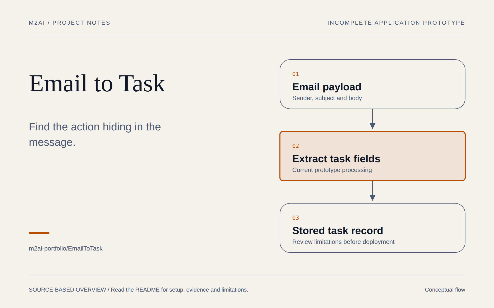

# EmailToTask



An important request arrives by email. Copying it into a task list is one more manual step, and it is easy to lose the follow-up. EmailToTask explores a shorter path: forward the message, assign a priority and category, and create a task record with a confirmation email.

**Status: an early implementation prototype.** This public source contains a landing page, a Supabase schema, an email-processing API and a Stripe webhook handler. It does not contain the signup, login, dashboard or checkout flows advertised on the landing page. The parser is keyword-based, not an AI model. Use it as a workflow and data-model example, not a finished SaaS product.

## What is implemented

- A Next.js 14 and React landing page that presents the forwarding concept.
- `POST /api/process-email`: find an active forwarding address, parse a message, store an email and task, and attempt a Resend confirmation.
- Supabase tables for profiles, tasks, email records and forwarding addresses, with row-level-security policies.
- A Stripe webhook route that verifies signatures and updates subscription-related data.

The task pipeline separates intake, parsing, storage and notification. That is the useful architecture to inspect when adapting this prototype.

## Set up a development copy

Use Node.js 20 or later and npm. The repository has no lockfile or Node engine pin, so dependency resolution is not a fully reproducible environment.

```bash
git clone https://github.com/m2ai-portfolio/EmailToTask
cd EmailToTask
npm install
npm run dev -- --hostname 0.0.0.0 --port 3000
```

On ProBook, open [the landing page](http://10.0.0.46:3000). Use the host's LAN address elsewhere. The static landing page is the first review surface. Its signup and dashboard links are placeholders in this export.

For the API, provide your own isolated Supabase project, Resend sender and Stripe test configuration. Read [.env.local.example](.env.local.example) for variable names, but replace the sample service URLs, price IDs and domain with your own. Supply values through your environment. On ProBook, load `~/.env.shared` first; do not create another project secret file.

| Variable | Purpose |
| --- | --- |
| `NEXT_PUBLIC_SUPABASE_URL`, `NEXT_PUBLIC_SUPABASE_ANON_KEY` | Your Supabase project and public client configuration |
| `SUPABASE_SERVICE_ROLE_KEY` | Server-side access for ingest and webhook routes; never expose it to the browser |
| `RESEND_API_KEY` | Confirmation email delivery |
| `STRIPE_SECRET_KEY`, `STRIPE_WEBHOOK_SECRET` | Stripe test API and webhook verification |

Review and apply [the migration](supabase/migrations/001_initial_schema.sql) to that disposable database using your normal Supabase workflow. Create a test user and an active forwarding-address record for that user. The repository does not configure an inbound email provider for you. Confirmation sender and dashboard URLs are currently hard-coded in the processing route and must be adapted before external use.

## Walk through the pipeline

1. Open [the processing route](app/api/process-email/route.ts). Follow the address lookup through parsing, email insertion, task insertion and notification.
2. In an isolated configured environment, send a test JSON request with `to`, `from`, `subject`, `body` and optional `html`. The recipient must match your test forwarding-address row. A successful call writes records and attempts to email the supplied sender, so use an inbox you control.
3. Check the returned `taskId` against the task row and related email record. Verify priority and category behavior with an urgent subject and a follow-up phrase.
4. Try an unknown forwarding address; expect HTTP 404. Independently check the test inbox, because an API success does not prove delivery: notification errors are logged without failing the request.

## Checks and known gaps

`npm run build` and `npm run lint` are the supplied checks. No automated test script is included. Builds that load API modules need valid configuration; a rendered landing page does not validate ingestion or billing.

- Date parsing currently substitutes the current timestamp when it matches a pattern. It does not extract the actual requested due date.
- Parsed output does not populate title or description; tasks fall back to “Task from email” and an empty description.
- When HTML is absent, the current route passes the subject as the parser's preferred content. Body-only urgency can therefore be missed.
- Email ingestion lacks provider signature verification, request validation, idempotency and an atomic email/task transaction. Do not expose it publicly as-is.
- Analytics, two-way sync, AI extraction, subscription checkout and the task dashboard are not implemented here. The marketing copy is a product concept, not proof of these capabilities.

## Source map

| Path | Read it for |
| --- | --- |
| [app/page.tsx](app/page.tsx) | Product concept and landing page |
| [app/api/process-email/route.ts](app/api/process-email/route.ts) | Intake-to-task workflow and current parser limitations |
| [lib/supabase.ts](lib/supabase.ts) | Typed records and database helpers |
| [app/api/webhooks/stripe/route.ts](app/api/webhooks/stripe/route.ts) | Signed billing events |
| [supabase/migrations/001_initial_schema.sql](supabase/migrations/001_initial_schema.sql) | Tables, policies and triggers |

No license file is included in this snapshot. Check reuse terms with the repository owner before redistributing it.
